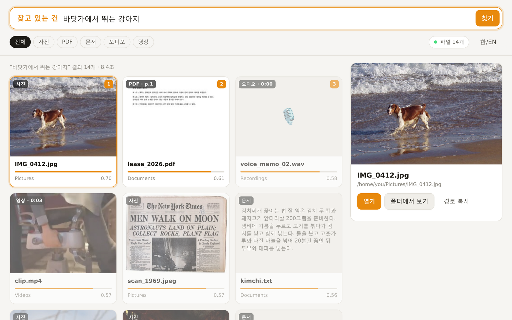
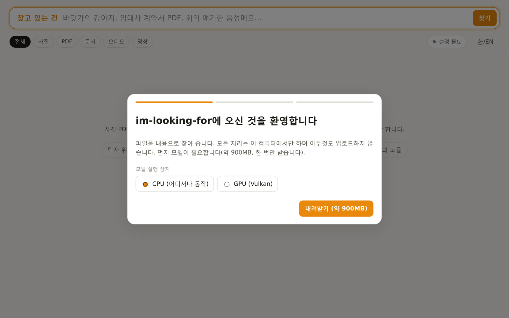
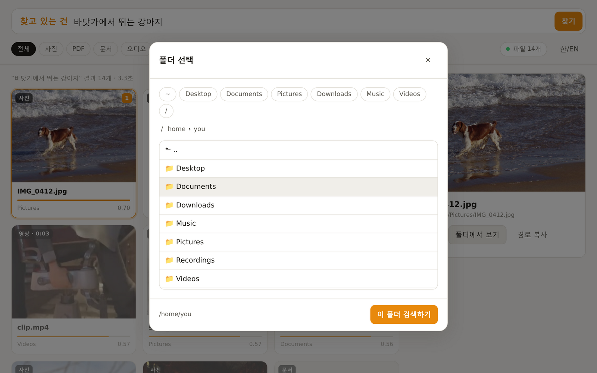
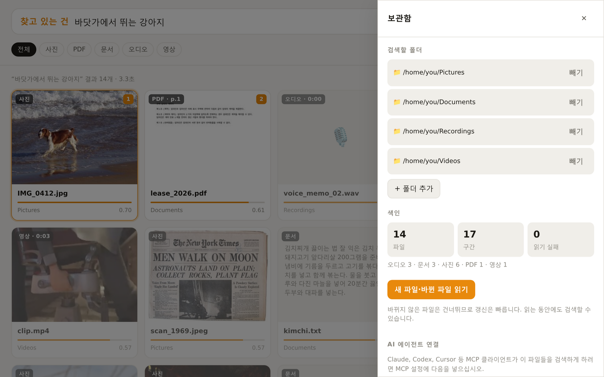

# im-looking-for

[English](README.md) · **한국어**

**설명하면 찾아 줍니다.** 사진·PDF·문서·음성메모·팟캐스트·영상을 파일 이름이 아니라 **안에 담긴 내용**으로
검색합니다. **Windows, macOS, Linux**에서 동작하며 모든 처리는 이 컴퓨터 안에서 끝납니다. 아무것도 업로드하지
않습니다. 사람과 **AI 에이전트** 모두를 위해 만들었습니다. 검색 창, 한 단어짜리 CLI, 모든 명령의 `--json`,
그리고 MCP 서버를 제공합니다.



```console
$ ilf 바닷가에서 뛰는 강아지
 1. 0.702  [image]  ~/Pictures/IMG_0412.jpg
$ ilf 임대차 계약 해지 조건
 1. 0.916  [pdf p.1]  ~/Documents/lease_2026.pdf
      주택 임대차 계약서 제1조 (목적) …
$ ilf -k audio 잠이 안 온다고 말한 녹음
 1. 0.647  [audio 0:00]  ~/Recordings/voice_memo_01.wav
```

Google DeepMind의 [EmbeddingGemma 2](https://huggingface.co/google/embeddinggemma-2)(Apache 2.0, 7.4억
파라미터)를 [llama.cpp](https://github.com/ggml-org/llama.cpp)로 실행합니다. 이 모델은 글·그림·소리·영상을 하나의
공간에 놓고 100개 이상의 언어를 이해합니다. 데스크톱에서 이 일을 처음 해낸 macOS 앱
[DigUp](https://github.com/ARahim3/DigUp)을 여러 운영체제에서 쓸 수 있게 다시 만든 프로젝트입니다.

## 설치

Python 3.10 이상이 필요합니다. 이 저장소를 내려받은 뒤 다음을 실행하십시오.

```sh
pipx install ./im-looking-for      # 또는 uv tool install ./im-looking-for · pip install ./im-looking-for
ilf                                # 앱이 열리고, 처음이면 설정을 안내합니다
```

Python 없이 쓰려면 릴리스 워크플로가 만드는 Windows·macOS·Linux 단독 실행본을 Releases에서 받으십시오.

처음 한 번 llama.cpp(12~35MB)와 모델(865MB)을 내려받습니다. 버전을 고정하고 SHA-256으로 검증합니다. 컴퓨터에
맞는 llama.cpp를 자동으로 고릅니다. Apple Silicon은 **Metal**, Windows는 **Vulkan**(최근 NVIDIA·AMD·Intel GPU),
Linux와 Intel Mac은 **CPU**입니다. GPU가 있는 Linux는 설정 화면이나 `ilf setup --backend vulkan`으로 Vulkan을
고를 수 있습니다(`libvulkan1` 필요).

## 앱

`ilf`만 입력하면 앱이 열립니다. Chromium 계열 브라우저가 있으면 독립된 앱 창으로, 없으면 브라우저 탭으로
열리며, 이 컴퓨터에서만 접속할 수 있습니다.

| 첫 실행 | 폴더 고르기 | 보관함·에이전트 연결 |
|---|---|---|
|  |  |  |

- **세 단계 설정**: 진행 막대를 보며 모델을 내려받고, 내장 폴더 탐색기로 폴더를 고르고, 첫 색인 진행을 확인합니다.
  색인이 이어지는 동안에도 이미 읽은 파일은 바로 검색할 수 있습니다.
- **문장처럼 검색**: “찾고 있는 건 … 철물점 영수증”. 입력을 멈추면 결과가 나옵니다. 사진·PDF·문서·오디오·영상으로
  거를 수 있습니다.
- **왜 찾았는지 보여 줌**: 사진, 일치한 PDF 쪽, 일치한 순간의 영상 프레임을 미리 보여 주고, 일치한 구간을 검색어를
  강조해 보여 줍니다. 관련이 약한 결과는 흐리게 표시합니다.
- **키보드 우선**: `/` 검색, 화살표 이동, `Enter` 열기, `Shift+Enter` 폴더에서 보기, `Esc` 지우기.
- **보관함**: 폴더 추가·빼기, 새 파일·바뀐 파일 읽기, 색인 현황 확인, AI 에이전트용 MCP 설정 복사.
- **한국어와 영어**: 시스템 언어를 따르며 한/EN 버튼으로 바꿀 수 있습니다.

## 명령줄

```sh
ilf <설명>                         # 검색: 명령어가 아닌 말은 모두 검색어로 봅니다
ilf -k image -n 5 빨간 자동차      # 옵션 위치는 자유: --kind image|pdf|doc|audio|video, --limit, --open N
ilf search setup 방법              # 검색어가 명령어 이름으로 시작하면 search를 붙이십시오
ilf add ~/Pictures ~/Documents     # 검색할 폴더
ilf index                          # 읽기. 다음부터는 바뀐 것만 읽습니다
ilf status                         # 설치·색인 현황
ilf serve --port 8765              # 앱(`ilf`만 입력해도 같음). --browser-tab, --no-browser
ilf setup [--backend vulkan]       # 앱 없이 llama.cpp와 모델 내려받기
ilf mcp                            # AI 에이전트용 MCP 서버(stdio)
```

모든 명령에 `--json`을 붙일 수 있습니다. 종료 코드는 `0` 완료, `1` 결과 없음(색인이 비었거나 필터를 통과한 파일이 없음), `2` 오류, `3` 설정 전입니다.
검색은 언제나 가장 가까운 파일을 돌려주므로 점수는 결과끼리 비교해 읽어야 합니다. [docs/agents.ko.md](docs/agents.ko.md)를 참고하십시오.

## AI 에이전트용

에이전트가 혼자서는 할 수 없는 일을 맡깁니다. 사용자가 파일 이름을 기억하지 못해도 사진·스캔·슬라이드·녹음을
가로질러 내용으로 파일을 찾습니다.

```sh
claude mcp add im-looking-for -- ilf mcp                     # Claude Code
codex mcp add im-looking-for -- ilf mcp                      # Codex CLI
```

다른 MCP 클라이언트(Claude Desktop, Cursor 등)의 JSON 설정에는 다음을 넣으십시오.

```json
{ "mcpServers": { "im-looking-for": { "command": "ilf", "args": ["mcp"] } } }
```

도구는 `search`, `read_passages`, `status`, `add_folder`, `remove_folder`, `index`(백그라운드 실행),
`stop_indexing`입니다. MCP가 없는 에이전트는 `ilf <검색어> --json`을 쓰면 됩니다. JSON 구조·종료 코드·점수의
의미 등 전체 계약은 [docs/agents.ko.md](docs/agents.ko.md)에 있습니다. 바로 쓸 수 있는 스킬
[`skills/im-looking-for/SKILL.md`](skills/im-looking-for/SKILL.md)와 [`llms.txt`](llms.txt)도 제공합니다.

## 읽는 파일

| 파일 | 읽는 방법 |
|---|---|
| 그림: jpg, png, webp, gif, bmp, tiff | 그림 자체(256px 미만 아이콘은 건너뜀) |
| PDF | 쪽마다 글자. 글자가 거의 없는 쪽(스캔, 슬라이드)은 그림으로 읽음 |
| 문서: txt, md, html, csv, srt, docx, pptx, xlsx, odt, hwpx 등 | 약 1,600자 단위 |
| 소리: mp3, wav, m4a, flac, ogg, opus 등 | 25초 간격으로 30초 구간 |
| 영상: mp4, mov, mkv, webm, avi 등 | 3초마다 프레임 하나(같은 장면 제외)와 소리 |
| 모든 파일 | 키워드 검색용 파일 이름과 폴더 이름 |

의미 검색과 정확한 단어 검색을 함께 씁니다. 단어 검색은 SQLite trigram 색인을 써서 한국어·일본어·중국어에서도
동작합니다. `고양이`로 `고양이가`를 찾고, `임차`처럼 두 글자 단어도 일치합니다.

숨김 폴더(`.ssh`, `.git` 등), 의존성·빌드 폴더, 앱 번들, 키·인증서, 비밀값처럼 보이는 이름의 파일은 읽지 않고,
지정한 폴더 밖을 가리키는 링크도 따라가지 않습니다. 파일을 읽기만 할 뿐 바꾸거나 옮기거나 업로드하지 않습니다.

## 개인정보와 보안

- 모델은 로컬 llama.cpp 프로세스에서, 색인은 로컬 SQLite 파일에서 동작합니다. 네트워크는 최초 1회 GitHub(llama.cpp)와
  Hugging Face(모델)에서 내려받을 때만 씁니다.
- 앱은 `127.0.0.1`에서만 열리고 `Host` 헤더를 확인하며, 모든 요청에 세션별 토큰을 요구합니다. 미리보기·구간 보기·열기는
  이미 색인된 파일에만 허용합니다.
- 데이터는 폴더 하나에 모입니다(`ILF_HOME`으로 바꿀 수 있음). Windows는 `%LOCALAPPDATA%\im-looking-for`, macOS는
  `~/Library/Application Support/im-looking-for`, Linux는 `~/.local/share/im-looking-for`입니다. 지우려면 패키지를
  제거하고 이 폴더를 삭제하십시오.

## 동작 방식

```
폴더 ─► 읽기(Pillow, PDFium, ffmpeg) ─► 구간: 그림 한 장, 한 쪽, 글 한 토막, 소리 30초, 프레임 하나
     ─► llama-server(llama.cpp)가 EmbeddingGemma 2 실행. 임의의 루프백 포트에서 도는 보조 프로세스
     ─► index.sqlite: 구간마다 768차원 벡터(float16) + trigram 키워드 색인
검색어 ─► 같은 모델의 텍스트 부분 ─► 모든 벡터와 코사인 유사도 + 정확한 단어 가산점 ─► 파일당 결과 하나
```

프롬프트는 모델 카드를 따릅니다(`task: search result | query: …`, `title: … | text: …`). 색인은 어떤 모델 빌드와
읽기 설정으로 만든 벡터인지 기록하고, 이것이 바뀌면 새로 시작하므로 서로 다른 벡터가 섞이지 않습니다.

## 속도와 품질

다른 작업으로 바쁜 6코어 Intel i5-9500에서 CPU 빌드로 측정했습니다. 그림 한 장 약 7초, 1,300자 글 약 2초, 30초
소리 약 1.3초가 걸리고, 검색은 모델이 올라온 뒤 0.1~3초입니다(앱은 시작할 때 모델을 미리 올립니다). GPU 빌드는
훨씬 빠릅니다. 큰 폴더의 첫 색인은 오래 걸리지만 그다음부터는 새 파일과 바뀐 파일만 읽습니다.

`scripts/make_testbed.py`로 작은 혼합 폴더(Wikimedia Commons 사진, 한국어 임대차 계약서 PDF, 메모, .docx 논문,
음성메모, 영상)를 만들고 `scripts/eval.py scripts/testbed_eval.json`으로 영어·한국어 질의 14개를 채점합니다.
결과는 **top-1 12/14, top-5 14/14, MRR 0.911**입니다. 놓친 두 건은 “red fruit”에서 `Red_Apple.jpg`라는 이름이 적힌
`SOURCES.txt`가 사과 사진보다 앞선 경우와, espeak-ng로 합성한 한국어 음성메모를 이해하지 못한 경우입니다. 작은
시험용 폴더이며 벤치마크가 아닙니다.

## 개발

```sh
python -m venv .venv && . .venv/bin/activate      # Windows: .venv\Scripts\activate
pip install -e ".[dev]"
pytest                                             # 단위 테스트: 모델 불필요
ILF_INTEGRATION=1 ILF_REAL_HOME=<setup 후 데이터 폴더> pytest tests/test_integration.py
python scripts/shots.py docs/images --lang ko      # 앱 스크린샷(playwright 필요)
```

CI는 Windows·macOS·Linux에서 단위 테스트를 돌리고, 각 운영체제에서 llama.cpp와 모델을 내려받아 그림 한 장과
한국어·영어 메모를 색인한 뒤 검색이 이를 찾는지 확인합니다. 구조와 수정 규칙은 [AGENTS.md](AGENTS.md)를
참고하십시오.

## 한계

- 지금까지 직접 실행해 확인한 것은 Linux뿐입니다. Windows와 macOS는 CI로만 확인합니다.
- HEIC/HEIF 사진은 아직 읽지 못합니다(Pillow 플러그인 필요).
- 사진·스크린샷 속 글자는 OCR이 아니라 모델의 시각으로만 “보기” 때문에 정확한 단어 검색으로는 찾을 수 없습니다.
- 코드 검색은 구현하지 않았습니다.
- 색인은 요청할 때만 합니다(`ilf index`, 앱의 버튼, 에이전트의 `index` 도구). 폴더 변경 자동 감시는 아직 없습니다.

## 라이선스

MIT. llama.cpp(MIT), EmbeddingGemma 2(Apache 2.0, Gemma 금지 사용 정책), Python 의존성은
[THIRD_PARTY_NOTICES.md](THIRD_PARTY_NOTICES.md)를 참고하십시오.
