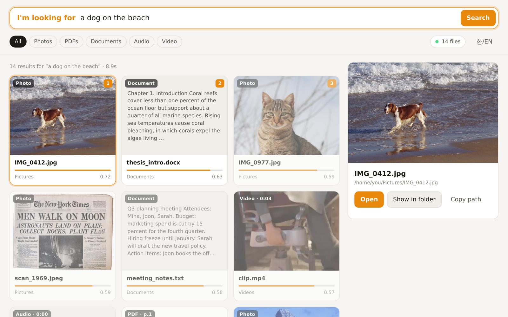
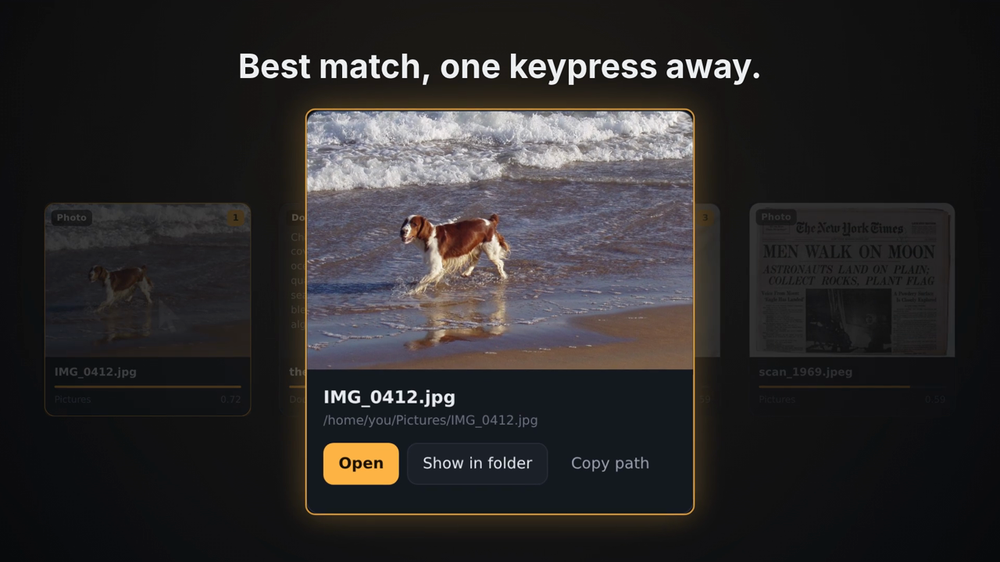
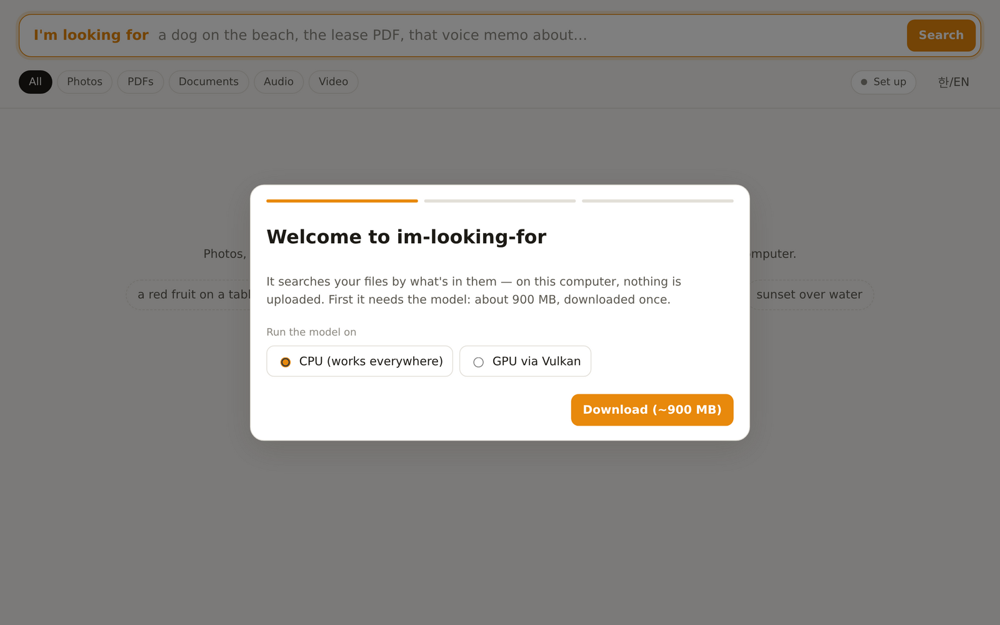
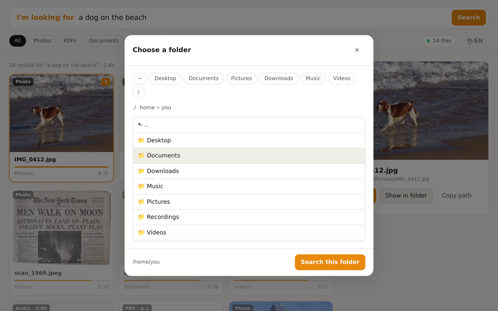
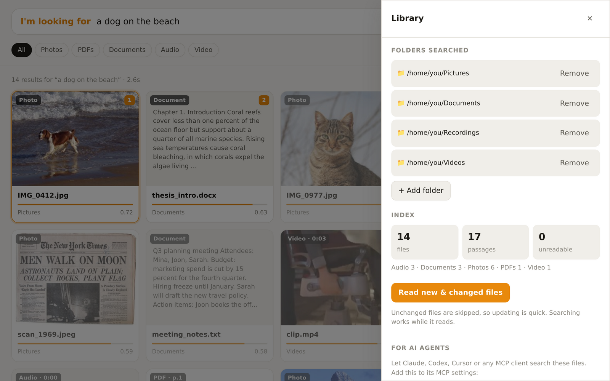

# im-looking-for

**English** · [한국어](README.ko.md)

**Describe it. im-looking-for finds it.** Search the files on your computer by what's *in* them — photos, PDFs,
documents, voice memos, podcasts and videos — on **Windows, macOS and Linux**. Everything runs on your machine; nothing
is uploaded. Built for people *and* for AI agents: a search window, a one-word CLI, `--json` everywhere and an MCP
server.



[](docs/media/promo.mp4)

*20-second promo ([mp4](docs/media/promo.mp4)). Every screen in it is a capture of the real app, and the terminal shows the
verbatim output of `ilf a dog on the beach --json`.*

```console
$ ilf a dog running on the beach
 1. 0.723  [image]  ~/Pictures/IMG_0412.jpg
$ ilf 임대차 계약 해지 조건
 1. 0.916  [pdf p.1]  ~/Documents/lease_2026.pdf
      주택 임대차 계약서 제1조 (목적) …
$ ilf -k audio where I talk about sleep problems
 1. 0.742  [audio 0:00]  ~/Recordings/voice_memo_01.wav
```

im-looking-for is built on Google DeepMind's [EmbeddingGemma 2](https://huggingface.co/google/embeddinggemma-2)
(Apache 2.0, 740M parameters), which puts text, pictures, sound and video into one shared space and understands 100+
languages, run by [llama.cpp](https://github.com/ggml-org/llama.cpp). It's a cross-platform take on
[DigUp](https://github.com/ARahim3/DigUp), the macOS app that first did this on the desktop.

## Install

Python 3.10 or newer. Any one of these (no git needed):

```sh
uv tool install https://github.com/yazzang-homelab/im-looking-for/archive/refs/heads/main.zip
pipx install https://github.com/yazzang-homelab/im-looking-for/archive/refs/heads/main.zip
pip install https://github.com/yazzang-homelab/im-looking-for/archive/refs/heads/main.zip
```

Then run `ilf`: it opens the app, and the first run walks you through setup. On Windows, if `ilf` isn't found after
`pip install`, run `python -m im_looking_for`, or install with `uv`/`pipx`, which put `ilf` on the PATH
(`uv tool update-shell` / `pipx ensurepath` once, then open a new terminal). From a clone: `pipx install .`.

Prefer no Python? Download the standalone build for Windows, macOS or Linux from
[Releases](https://github.com/yazzang-homelab/im-looking-for/releases), unzip it and run `ilf`. The builds aren't
code-signed yet, so Windows shows "Windows protected your PC" / "Unknown publisher" for a downloaded `ilf.exe`: choose
**More info → Run anyway**, or unblock the zip before unzipping it (right-click → Properties → **Unblock**, or
`Unblock-File ilf-windows-x64.zip`). Installing with `uv`/`pipx`/`pip` above shows no such warning. On macOS,
right-click → **Open** the first time.

The first run downloads llama.cpp (12–35 MB) and the model (865 MB) once, pinned to exact versions and checked by
SHA-256. It picks the llama.cpp build for your computer: **Metal** on Apple Silicon, **Vulkan** on Windows (any recent
NVIDIA/AMD/Intel GPU), the **CPU** on Linux and Intel Macs; Linux with a GPU can choose Vulkan in the setup screen or
with `ilf setup --backend vulkan` (needs `libvulkan1`). If the GPU build can't start or crashes (a laptop
without a working GPU driver), it runs on the processor instead and remembers why (`ilf status`); **Library → Model runs
on** switches builds later.

## The app

Run `ilf` with nothing after it. It opens a window (a Chromium-family browser in app mode if you have one, otherwise a
browser tab) served only to your own computer.

| First run | Choosing folders | Library and agent setup |
|---|---|---|
|  |  |  |

- **Setup in three steps**: download the model with a progress bar, pick folders in a built-in folder browser, watch
  the first pass read your files. You can search what's been read while it continues.
- **Search like a sentence**: "I'm looking for … a receipt from the hardware store". Results arrive as you pause
  typing. Filter by Photos, PDFs, Documents, Audio or Video.
- **See why it matched**: thumbnails of the photo, the PDF page or the video frame at the matching second; the passage
  that matched, with your words highlighted; weaker matches are dimmed.
- **Keyboard first**: `/` to search, arrows to move, `Enter` to open, `Shift+Enter` to show in folder, `Esc` to clear.
- **Library**: add and remove folders, read new and changed files, see what's indexed, and copy the MCP setup for your
  AI agent.
- **English and Korean**, following your system language (switch with 한/EN).

## The command line

```sh
ilf <description>                  # search: anything that isn't a command is a description
ilf -k image -n 5 red car          # options go anywhere: --kind image|pdf|doc|audio|video, --limit, --open N
ilf search setup instructions      # use `search` when your words start like a command
ilf add ~/Pictures ~/Documents     # folders to search
ilf index                          # read them; later runs only read what changed
ilf status                         # what's installed and indexed
ilf serve --port 8765              # the app (`ilf` alone does this); --browser-tab, --no-browser
ilf setup [--backend vulkan]       # download llama.cpp and the model without the app
ilf mcp                            # MCP server on stdio, for AI agents
```

Every command takes `--json`. Exit codes: `0` done, `1` no results (the index is empty or nothing passes the filters), `2` error, `3` not set up
yet. A search always returns the nearest files, so read scores relative to each other; see [docs/agents.md](docs/agents.md).

## For AI agents

im-looking-for gives an agent what it can't otherwise do: find a file by what's in it, across photos, scans, slides and
recordings, without the user remembering its name.

```sh
claude mcp add im-looking-for -- ilf mcp                     # Claude Code
codex mcp add im-looking-for -- ilf mcp                      # Codex CLI
```

Or in any MCP client's JSON settings (Claude Desktop, Cursor, …):

```json
{ "mcpServers": { "im-looking-for": { "command": "ilf", "args": ["mcp"] } } }
```

Tools: `search`, `read_passages`, `status`, `add_folder`, `remove_folder`, `index` (runs in the background), and
`stop_indexing`. Agents without MCP can use `ilf <query> --json`. The full contract (JSON shapes, exit codes, what a
score means) is in [docs/agents.md](docs/agents.md). There's also a ready-made skill at
[`skills/im-looking-for/SKILL.md`](skills/im-looking-for/SKILL.md) and an [`llms.txt`](llms.txt).

## What it reads

| Files | How |
|---|---|
| Pictures: jpg, png, webp, gif, bmp, tiff | the picture itself (icons under 256 px are skipped) |
| PDF | each page's text; a page with almost no text (a scan, a slide) is read as a picture |
| Documents: txt, md, html, csv, srt, docx, pptx, xlsx, odt, hwpx, … | stretches of ~1,600 characters |
| Sound: mp3, wav, m4a, flac, ogg, opus, … | 30-second windows, every 25 seconds |
| Video: mp4, mov, mkv, webm, avi, … | a frame every 3 seconds (repeats dropped) and the soundtrack |
| Every file | its name and folders, for keyword search |

Searches mix meaning and exact words. Exact words use SQLite's trigram index, so they work in Korean, Japanese and
Chinese too: `고양이` finds `고양이가`, and two-letter words like `임차` still match.

It never reads hidden folders (`.ssh`, `.git`, …), dependency or build folders, app bundles, keys, certificates or files
named like secrets, and never follows links out of the folders you give it. It only reads files; it never changes,
moves or uploads them.

## Privacy and safety

- The model runs in a local llama.cpp process; the index is a local SQLite file. Nothing is sent anywhere. The only
  network use is the one-time download from GitHub (llama.cpp) and Hugging Face (the model).
- The app listens on `127.0.0.1` only, checks the `Host` header, and requires a per-session token on every request.
  Previews, passages and "open" work only for files already in the index.
- Data lives in one folder (`ILF_HOME` overrides it): `%LOCALAPPDATA%\im-looking-for` on Windows,
  `~/Library/Application Support/im-looking-for` on macOS, `~/.local/share/im-looking-for` on Linux. To remove
  im-looking-for, uninstall the package and delete that folder.

## How it works

```
folders ─► readers (Pillow, PDFium, ffmpeg) ─► segments: a picture, a page, a stretch of text, 30 s of sound, a frame
        ─► llama-server (llama.cpp) running EmbeddingGemma 2, a helper process on a random loopback port
        ─► index.sqlite: a 768-d vector per segment (float16) + a trigram keyword index
query   ─► the same model's text part ─► cosine similarity against every vector + exact-word boost ─► one result per file
```

Prompts follow the model card (`task: search result | query: …`, `title: … | text: …`). The index records which model
build and reading settings made its vectors and starts over when they change, so vectors never mix.

## Speed and quality

Measured on a 6-core Intel i5-9500 with the CPU build, while the machine was busy with other work: a picture takes
~7 s, a 1,300-character stretch of text ~2 s, a 30-second sound window ~1.3 s; a search 0.1–3 s once the model is
loaded (the app loads it at start). The first pass over a big folder is slow; after that only new and changed files
are read.

With a GPU it's a different picture. On Windows 11 with an AMD Radeon RX 9070 XT (default Vulkan build), `ilf setup`
finished in 34 s including both downloads, the test folder below (15 files: 6 photos, 4 documents, a PDF, 3 voice
memos, a video) was read in 10 s, and its 14 test queries ran in 3 s together, with the same scores as on Linux.

`scripts/make_testbed.py` builds a small mixed folder (Wikimedia Commons photos, a Korean lease as PDF, notes, a thesis
as .docx, spoken memos, a video) and `scripts/eval.py scripts/testbed_eval.json` scores 14 English and Korean queries
against it: **top-1 12/14, top-5 14/14, MRR 0.911**. The misses: "red fruit" ranks the testbed's own `SOURCES.txt`
(which names `Red_Apple.jpg`) above the apple photo, and a Korean memo synthesized with espeak-ng isn't understood.
It's a small testbed, not a benchmark.

## Develop

```sh
python -m venv .venv && . .venv/bin/activate      # Windows: .venv\Scripts\activate
pip install -e ".[dev]"
pytest                                             # unit tests: no model needed
ILF_INTEGRATION=1 ILF_REAL_HOME=<data folder after setup> pytest tests/test_integration.py
python scripts/shots.py docs/images --lang en      # screenshots of the app (needs playwright)
```

CI runs the unit tests on Windows, macOS and Linux, and an integration job on each that downloads llama.cpp and the
model, indexes a picture and a Korean/English note, and checks that searches find them. See [AGENTS.md](AGENTS.md)
for the layout and the rules for changing it.

## Limits

- Verified by hand on Linux and on Windows 11 (pipx install, setup, indexing, CLI, MCP, the app in Edge, the
  standalone build); macOS is covered by CI only.
- HEIC/HEIF photos aren't read yet (Pillow needs a plugin).
- Text inside photos and screenshots is "seen" by the model's vision, not OCR'd, so exact-word search doesn't reach it.
- Code search isn't implemented.
- Indexing runs when you ask (`ilf index`, the app's button, or the agent's `index` tool); there's no background
  folder watcher yet.

## License

MIT. See [THIRD_PARTY_NOTICES.md](THIRD_PARTY_NOTICES.md) for llama.cpp (MIT), EmbeddingGemma 2 (Apache 2.0, Gemma
Prohibited Use Policy) and the Python dependencies.
